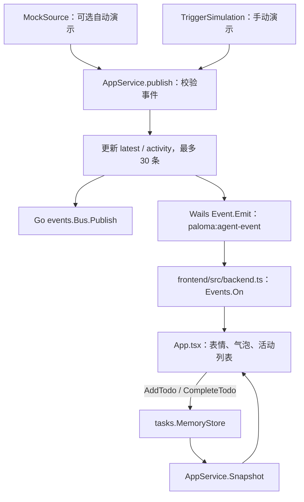

# Paloma 首期架构

本文以当前源码为准。“已实现”指已接入应用的路径；接口、模型和配置字段的存在不代表对应集成已完成。

## 1. 当前装配与事件流

`main.go` 创建 Wails v3.0.0 应用、透明置顶窗口与 `AppService`，嵌入 `frontend/dist/`，并注册 `paloma:agent-event` 的事件类型。`app_service.go` 装配模拟来源、Provider 注册表、Go 事件总线和内存仓储，应用退出时停止模拟来源。

`publish` 更新状态后，分别调用 Go 总线发布与 Wails 事件发送；**UI 直接订阅 Wails 事件，当前没有 Go 总线订阅者将消息转发给 UI**。Provider 注册表提供快照中的清单，当前事件生成路径没有调用 `Registry.Connect` 或消费 Runtime 的订阅通道。

## 2. 统一事件模型

`internal/domain/event.go` 定义 `AgentEvent`，供模拟来源、服务、事件总线及生成的前端类型共用。

| 字段 | 含义 |
| --- | --- |
| `schemaVersion` | 当前内部事件结构版本为字符串 `"1"` |
| `id`、`providerId`、`agentId` | 事件与来源标识 |
| `conversationId`、`runId` | 可选的会话与运行关联 |
| `type`、`status` | 事件类型和 Agent 状态 |
| `title`、`content` | 展示文本 |
| `progress` | 可选进度，范围为 0–100 |
| `requiresAction` | UI 需要关注的标记，不代表操作已获授权 |
| `createdAt`、`metadata` | 时间与可选扩展数据 |

事件类型包括 `agent.started/progress/message/waiting/completed/failed`，并预留 `todo.due`、`schedule.fired`；后两种尚无实际触发器。状态包括 `idle`、`queued`、`running`、`thinking`、`streaming`、`waiting_approval`、`completed`、`failed`、`cancelled`。

`Validate` 检查必要标识、标题、时间、结构版本、类型与状态枚举，以及进度的合法范围；不执行认证、去重或跨事件状态机检查。当前自动来源在开启后约每 7 秒产生一条事件，使用 `zcode` / `dsh` 标识；手动演示也通过同一发布入口。后端活动列表最多保存 30 条且不去重，前端实时列表按事件 ID 去重并截取 30 条，面板只显示最近 5 条。

## 3. AgentProvider、AgentRuntime 与 EventSource

`internal/domain/provider.go` 定义三个不同职责的边界：

| 边界 | 职责与当前状态 |
| --- | --- |
| `AgentProvider` | 提供 `Manifest()` 和 `Connect(ctx, config)`，描述能力并创建 Runtime |
| `AgentRuntime` | 声明 `Start/Stop/Send/Cancel/Subscribe/Health`，用于可交互 Agent 的生命周期、请求和事件订阅 |
| `EventSource` | 只有 `ID/Start/Stop`；通过回调投递统一事件，不要求具备聊天、取消或审批能力 |

`ProviderManifest` 包含 ID、显示名、`protocolVersion`、传输方式、能力列表与可选配置结构。代码枚举了 `embedded`、`stdio`、`http`、`websocket` 传输，以及聊天、流式输出、取消、审批等能力；这些只是描述边界，当前没有对应的真实传输适配器。内部 `schemaVersion` 和清单的 `protocolVersion` 也不构成对所有外部 Agent 协议的统一要求。

已实现的 `internal/agent/registry.go` 负责注册、拒绝空值/重复 ID、按 ID 连接及返回排序后的清单。应用注册两个 `SimulatedProvider`，显示为 ZCode 和 DSH，只声明 `embedded` 与 `health`。它们不是实际连接：模拟 Runtime 的 `Send` 仅向容量为 16 的通道写入一条开始事件，满时返回错误；`Cancel` 返回不支持，健康状态也只反映本地模拟生命周期。

实际桌面演示使用 `internal/agent/mock_source.go` 的 `MockSource`，它符合 EventSource 的方法形状，由 `StartSimulation` / `StopSimulation` 控制。自动演示默认不启动，停止后仍可使用 `TriggerSimulation`。该计时循环只服务于演示，不是 Automation 调度器。

`internal/sources/ports.go` 另有同样方法形状的 `Source` 接口与 `WebhookConfig`；它们尚未接入应用，没有 Webhook HTTP 路由、签名校验或监听服务。真实 ZCode / DSH、Pi / Hermes 的能力、传输和协议需按各自实际接口再确认，不能从名称或枚举推断已经支持。

## 4. 事件总线与 UI / Wails 边界

`internal/events/bus.go` 是进程内、带锁的发布订阅总线。订阅者获得缓冲 channel 与可重复调用的取消函数；缓冲至少为 1，发布不阻塞，订阅缓冲满时会丢弃本次消息。它没有持久化、重放、确认或可靠投递保证，后续若承载必须处理的任务，需要另行确定投递与恢复策略。

桌面 UI 的调用与订阅分为两条路径：

- **调用**：`frontend/src/backend.ts` 使用 `frontend/bindings/paloma/appservice.ts` 的生成绑定，获取 `Snapshot`、增添/完成待办、启停自动演示及触发模拟状态。`Snapshot` 包含最新事件、活动、Provider 清单、Todo、Automation 与模拟标记；`simulationMode` 当前始终为 `true`。
- **订阅**：`Events.On('paloma:agent-event', ...)` 读取 `event.data`，组件卸载时退订。`App.tsx` 先建立订阅再读取快照，并避免较旧快照覆盖已收到的较新事件。待办操作后通过重新读取快照更新列表，不产生 Todo 事件。

UI 在 `compact / notification / panel` 三种模式间切换，窗口尺寸分别为 `144 × 104`、`350 × 112`、`420 × 570`，布局逻辑位于 `frontend/src/windowLayout.ts`。默认紧凑；普通气泡约 5 秒后收起，`requiresAction=true` 或失败消息保留，且不会被后来的普通消息替换。打开面板会清除气泡，但不会执行审批。

当前表情由双层结构实现：`frontend/src/components/Mascot.tsx` 负责交互与状态（拖动判定、倾斜/挤压 CSS 变量、阴影、点击/拖动区分），脸层可切换——`face='hand'` 渲染自绘 SVG 双眼（眨眼、视线漫游由前端驱动），`face='aora'` 渲染 `@aora-bot/element` 的 `<aora-bot>` Web Component（弹簧物理引擎，情绪到状态的映射见 `AoraFace.tsx`：idle/working/thinking 直映，waiting→alerting，worried→sad，拖动→dragging）。切换入口在面板“状态演示”区，`?face=aora` 参数指定默认脸。

**Aora Bot 接入边界**：通过 Web Component 引入（不依赖 React 版本）；主包 gzip 增量约 130 KB，节日主题 chunk 按需加载；引擎 rAF 实测约 0.4% 单核 CPU（手绘脸为合成器动画，约 0%）。`AoraFace` 通过 `paused` 属性在不可见时暂停引擎。依据 Aora Bot 许可协议，个人/≤3 人团队免费（含商用），README 已保留署名。

前端运行于 **React 19**（2026-11-13 从 18.3 升级，JSX 类型声明相应迁移到 `declare module 'react'`）。`internal/notify/ports.go` 只定义通知策略接口，实际气泡判断在 React 中，尚未实现系统通知。

带 `?preview` 的浏览器页面改用 `backend.ts` 内独立的前端模拟后端，数据随刷新重置；它不走 Go 总线、Wails 服务调用或原生窗口 API。`frontend/components.json` 已配置 `@react-bits` registry，尚未安装其组件。

## 5. Todo / Automation 的内存边界

`internal/domain/task.go` 定义 Todo 与 Automation，`internal/tasks/store.go` 定义仓储接口和带锁的 `MemoryStore`，内部为两张 map。

| 数据 | 已实现 | 尚未接入 |
| --- | --- | --- |
| Todo | 创建、列表、更新及基础校验；AppService / UI 暴露添加和标记完成 | UI 编辑/删除、到期触发、持久化 |
| Automation | 创建和列表仓储方法；模型含一次性/间隔/cron 类型、时区、动作与运行时间字段 | AppService 创建入口、计划编辑器、调度及动作执行 |
| 活动记录 | AppService 内保存最近 30 条事件 | 磁盘历史、重放与重启恢复 |

`Automation.Validate` 检查必要字段、计划类型和时区是否有效，不解析 `Schedule` 表达式、不计算下次触发时间。`internal/scheduler/ports.go` 仅有 `Add/Remove/Start/Stop` 接口，没有实现；当前计划清单为空，页面为未开放占位。

所有待办、Automation 和活动均位于当前进程内存，重启丢失。没有 SQLite 初始化、数据文件或迁移逻辑，也没有执行 `AutomationAction.Payload` 的代码。未来可在现有仓储边界上增加持久化实现，但数据库选择、迁移及恢复方式仍需落实。

## 6. 后续接入与安全考量（未实现）

以下是后续设计需要处理的问题，不是首期已具备的安全机制或功能承诺：

- **真实 Agent 适配**：按各 Provider 的实际接口确认能力、传输、认证、取消和审批语义，将事件映射到内部模型；不预设所有来源必须采用同一种未确认协议。处理重连、退出清理、背压、顺序和重复事件。
- **外部事件入口**：若增加 Webhook / HTTP / WebSocket，确定监听范围和访问控制、密钥管理、签名/时间戳与防重放、请求大小和速率限制。现有 `WebhookConfig` 的布尔字段不等于已配置或验证了密钥。
- **操作授权**：限制文件路径、命令、工具和网络目标；将 UI 的“需要关注”与真实审批分开，未授权的通知不能直接执行动作。首期没有真实审批/执行链。
- **界面与隐私**：将外部内容视为不可信数据，避免直接注入 HTML 或任意链接；为通知、事件内容、日志及未来持久化数据确定脱敏、保留和删除策略。
- **持久化与调度**：确定迁移、并发/崩溃恢复、时区和夏令时、休眠唤醒、漏跑处理及动作幂等策略；在真正接入前，不能把内存模型或演示计时器视作可靠定时任务。

构建前置条件及 Windows 开发命令见 [README](../README.md)。构建与 bindings 生成以根 `Taskfile.yml`、`build/Taskfile.yml`、`build/windows/Taskfile.yml` 和 `build/config.yml` 为准。
